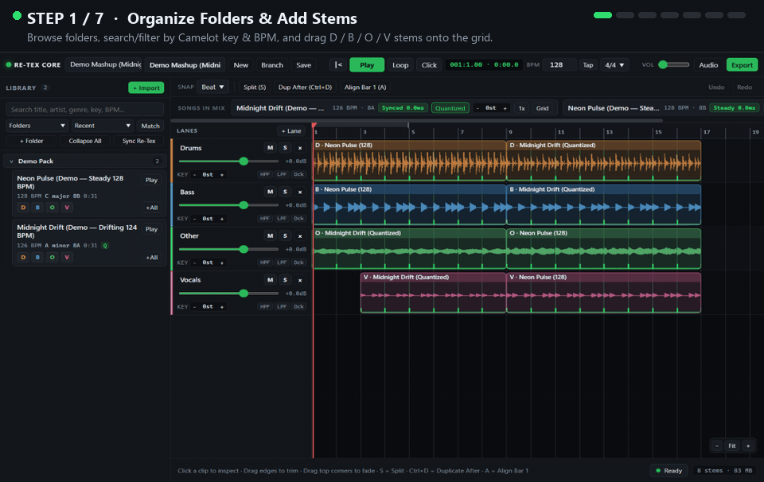
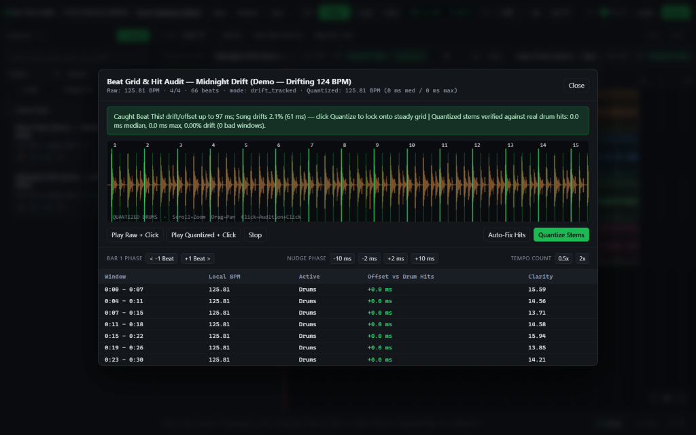

# Re-Tex Core

A lean, responsive multi-stem mashup DAW focused on the essentials that matter most: **transient-verified beat alignment, 1-click quantization, per-stem & per-clip key shifting, fast clip editing, zero-lag browser playback, and studio `-12 LUFS` export**.

<p align="center">
  <a href="https://texmexdex.github.io/re-tex-core/">
    
  </a>
</p>

<p align="center">
  <strong><a href="https://texmexdex.github.io/re-tex-core/">▶ Launch Re-Tex Core Web App (GitHub Pages — Local PC Proxy + Zero-Install Browser Mode)</a></strong>
  &nbsp;&middot;&nbsp;
  <a href="docs/demo_mashup.mp3">Listen to 30s Demo Bounce (MP3)</a>
</p>

## Two Modes in the Hosted Web App (`docs/`)

Opening **`https://texmexdex.github.io/re-tex-core/`** works in two seamless, 100% private modes (click the **`BROWSER LOCAL` / `LOCAL PC CONNECTED`** pill in the toolbar to configure or switch):

1. **Local PC Proxy Window (`LOCAL PC CONNECTED`)** — If **`Run Re-Tex Core.bat`** is running on your computer (`http://127.0.0.1:8770`), the hosted page automatically detects it via `/api/health` (with Chrome Private Network Access + CORS headers) and acts as a live frontend window into your local PC backend — full local library, CUDA Mel-Band Roformer / BS-Roformer separation, Rubber Band R3 warping, and `-12 LUFS` MP3/WAV export with zero audio ever leaving your machine.
2. **Zero-Install Browser-Local Mode (`BROWSER LOCAL`)** — Runs 100% locally in Chrome/Edge with no Python install required:
   - **Private SSD Storage:** Your imported songs, stems, beat grids, and projects are stored locally inside your browser's **IndexedDB** (`retex_core_browser_local_v1`) — nothing is uploaded anywhere.
   - **In-Browser AI 4-Stem Separation (WebGPU GPU + WASM CPU fallback):** Clicking **`+ Import`** separates MP3/WAV/FLAC songs into `drums / bass / other / vocals` locally via **HTDemucs ONNX** (`demucs-web` + `onnxruntime-web`), automatically using your GPU via **WebGPU** when available (with automatic WASM CPU fallback; ~172 MB model downloaded once and cached in IndexedDB).
   - **Instant Direct & Pre-Separated Stem Import:** Inside the **`BROWSER LOCAL`** settings modal, switch to **Instant Direct Import** or click **Import Pre-Separated Stems...** to load existing `*drums* / *bass* / *other* / *vocals*` files in seconds.
   - **Full Interactive DAW + Demo Pack:** Includes 2 pre-baked royalty-free 4-stem demo tracks, client-side zero-phase beat/key detection & drift quantization, `AudioWorklet` pitch shifting, **Split (`S`)**, **Duplicate After (`Ctrl+D`)**, and in-browser **WAV Export**.

---

## Try the Built-In Interactive Demo (Zero Downloads Needed!)

Want to see everything Re-Tex Core can do in **3 seconds** on a fresh install — without importing any songs or downloading AI weights?

```bash
python -m retex_core --demo
```
*(Or double-click **`Run Demo.bat`** on Windows.)*

Demo Mode runs in an isolated `./data_demo/` folder (never touching your main library) and synthesizes two royalty-free 4-stem tracks plus a ready-to-play mashup:
1. **`Midnight Drift (Demo)`** — 124→127.5 BPM (`A minor / 8A`) with an intentional **+95 ms off-beat initial beat map + live tempo drift** so you can inspect Re-Tex Core's Viterbi mistake catcher flagging the error and locking it to **`0.0 ms`** via 1-click **Quantize**.
2. **`Neon Pulse (Demo)`** — steady 128 BPM (`C major / 8B`, Camelot-compatible with `8A`).
3. **`Demo Mashup (Midnight Drift x Neon Pulse)`** — pre-arranged at `128 BPM` so you can immediately press **Space**, test **Split (`S`)**, **Duplicate After (`Ctrl+D`)**, per-stem **Key** shifting, **Beat Grid & Hit Audit**, and **Export**.

---

## Step-by-Step Workflow (Matches the GIF Above)

1. **Organize Folders & Add Stems** — Browse collapsible folders (or group by **Artists / Genres / Key / Tempo / Flat**), toggle **Match** to filter by Camelot key & tempo compatibility, click **`+All`** to drop all 4 stems aligned to Bar 1, or drag individual **`D / B / O / V`** chips onto any lane.
2. **Catch Off-Beat Grids & Quantize to `0.0 ms`** — Click **Grid** (or the colored sync badge) in **SONGS IN MIX** to inspect full-band zero-phase drum transients (`30–160 Hz` kick + `250–3500 Hz` snare). Click **Quantize** to warp all 4 stems onto a dead-steady beat grid with Rubber Band R3 + click-pilot correction, then verify every section hits `0.0 ms`.
   <p align="center"></p>
3. **Inspect Clips & Position Playhead** — Click any clip for numeric **Start, Len, Clip Pitch, Gain, Fade In/Out, and Rate (`0.5×/1×/2×`)** controls. Drag clip edges to trim and top-corner dots to fade.
4. **Split (`S`) & Duplicate After (`Ctrl+D`)** — Slice clips cleanly at the playhead and chain duplicates immediately after while preserving relative lane timing and green Bar-1 sync (`A` aligns Bar 1 to the nearest project bar).
5. **Shift Key Per-Song, Per-Stem, or Per-Clip** — Transpose a full song in **SONGS IN MIX** (drums stay unpitched), shift individual stems directly on each lane header (`KEY - 0st +`), or override a single clip (`Alt + Scroll` or Clip Inspector).
6. **Zero-Lag Browser Web Audio Playback & Progress Tracker** — Play, Stop, Seek, Mute, Solo, Gain, Pan, HPF, LPF, and Metronome Click run natively in Chrome's Web Audio `AudioContext` (`< 1 ms` Stop even while Rubber Band R3 warps in the background). Click the bottom-right **Progress Tracker pill** to view live task timers, cancel queued warps, or monitor the auto-evicting browser RAM cache.
7. **Master & Export** — Bounce bit-exact **24-bit WAV** or **320 kbps MP3** via 2-pass **`-12 LUFS`** loudness normalization with a `-1 dBFS` brickwall limiter.

---

## Quick Install (Standalone / Portable Laptop)

### Prerequisites
- **Python 3.11 – 3.13**
- **`ffmpeg`** on `PATH` (for MP3 export & compressed audio decoding — Windows: `winget install Gyan.FFmpeg`)

### Windows
```powershell
git clone https://github.com/Texmexdex/re-tex-core.git
cd re-tex-core
.\install.bat
```
Then double-click **`Run Re-Tex Core.bat`** (or **`Run Demo.bat`**) — opens `http://127.0.0.1:8770`.

### macOS / Linux
```bash
git clone https://github.com/Texmexdex/re-tex-core.git
cd re-tex-core
chmod +x install.sh && ./install.sh
.venv/bin/python -m retex_core --demo
```

---

## Standalone 2-Stage Clean Stem Separation (`retex_core/separate.py`)

When running in Standalone Mode (or with `RETEX_CORE_SEP=v2`) and optional `audio-separator` installed via `install.bat`, importing a new song uses a clean **2-Stage Cascade** designed to eliminate frequency loss, `-6 dB` vocal volume sinks, and vocals leaking into `other`:
1. **Stage 1 (Full-Band Vocals):** **Mel-Band Roformer** (`vocals_mel_band_roformer.ckpt`) extracts vocals cleanly, computing the exact residual instrumental (`inst = mix - vocals`).
2. **Stage 2 (Vocal-Free Instrumental Split):** Splits only the vocal-free instrumental into `drums` and `bass`, computing `other = inst - drums - bass` as an exact complement (`drums + bass + other + vocals == original mix` with zero Wiener-mask pumping).

---

## Environment Flags (Optional)

| Variable | Default | Purpose |
|---|---|---|
| `RETEX_CORE_STANDALONE` | `0` (auto) | Set to `1` to force standalone `./data/songs` library even if Re-Tex (`F:\mashup_lab`) is present |
| `RETEX_CORE_SEP` | `auto` | `v2` = 2-stage Mel-Band Roformer · `fast` = single-pass HTDemucs · `retex` = delegate to Re-Tex |
| `RETEX_CORE_PORT` | `8770` | Local HTTP port |
| `RETEX_CORE_DATA` | `./data` | Override projects/grids/cache/exports folder |

---

## Keyboard Shortcuts

| Key | Action |
|---|---|
| `Space` | Play / Stop (`< 1 ms` native Web Audio) |
| `Home` | Jump playhead to Bar 1 |
| `S` | Split selected clip(s) at playhead |
| `Ctrl+D` | Duplicate After (chains selection preserving offsets & lanes) |
| `A` | Align Bar 1 to nearest project bar |
| `M` | Mute / Unmute selected clip(s) |
| `L` / `K` | Toggle Loop (`Shift+Drag` ruler to set range) / Metronome Click |
| `Ctrl+C` / `Ctrl+V` | Copy / Paste clips |
| `Ctrl+Z` / `Ctrl+Y` | 150-step Undo / Redo |
| `Ctrl+S` | Save project |
| `Alt + Scroll` | Nudge clip pitch (`±1 st`) · `Ctrl + Scroll` Zoom · `Shift + Scroll` Pan |
